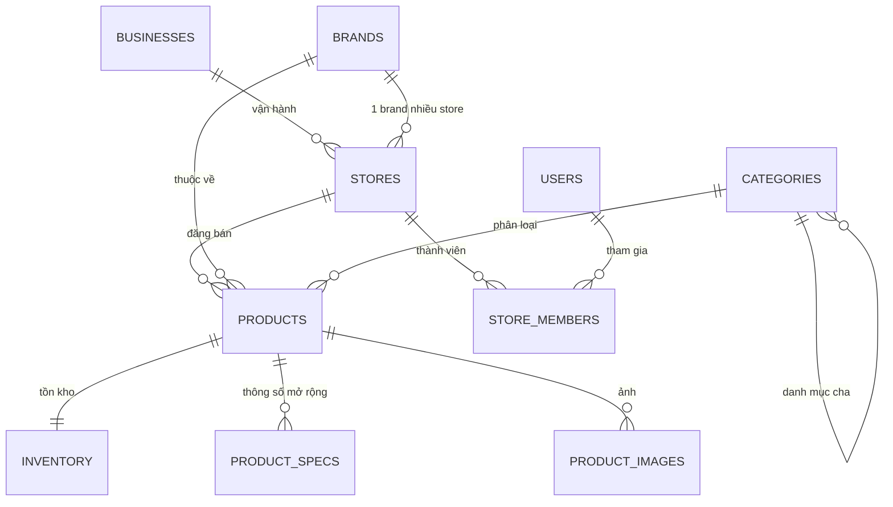
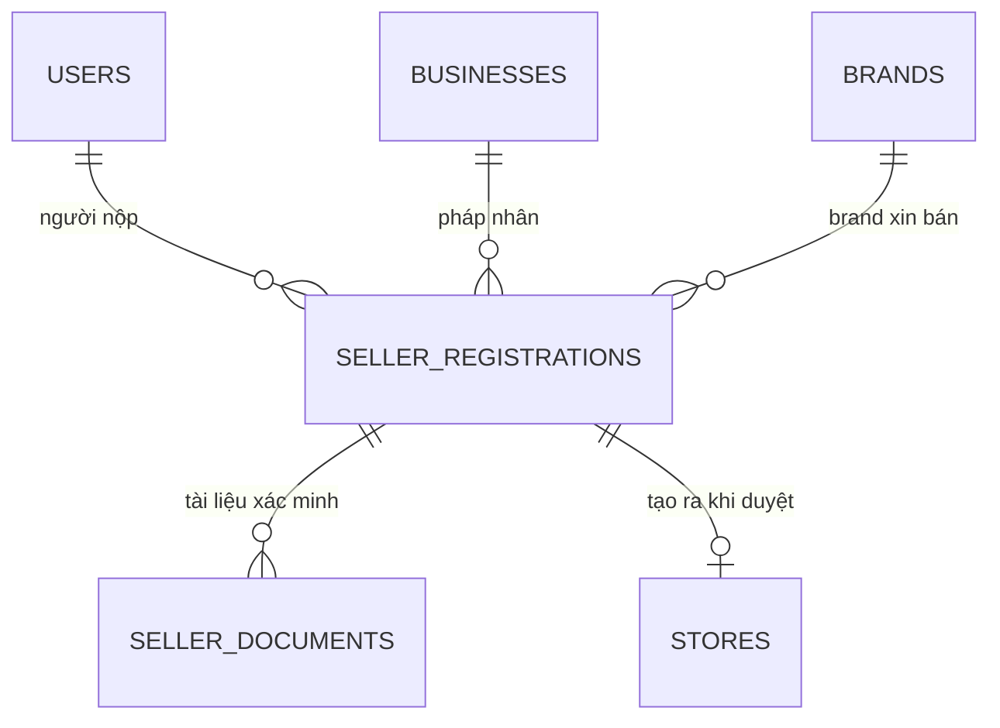
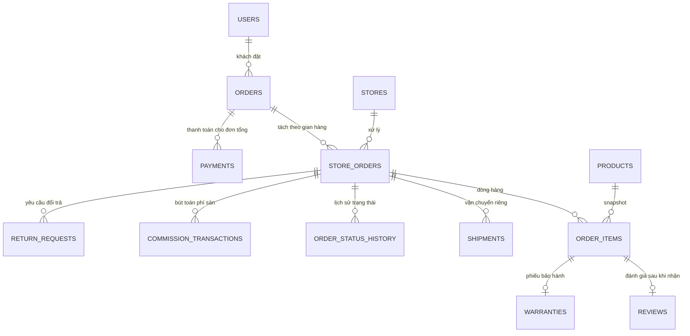
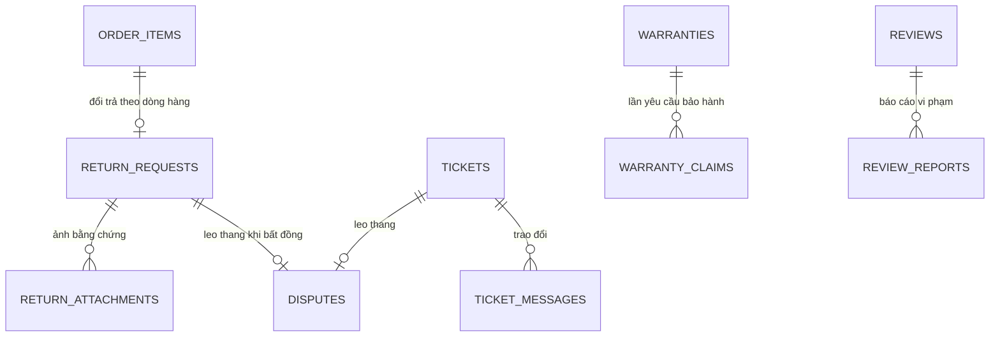

# Thiết kế cơ sở dữ liệu — SmartWash

> Bám theo *Tài liệu mô tả dự án sàn thương mại điện tử máy giặt, phiên bản 1.1*.
> Hệ quản trị: **SQL Server 2022**. Tầng dữ liệu: Spring Data JPA.
> Tài liệu này là nguồn tham chiếu duy nhất về cấu trúc bảng; sửa bảng thì phải sửa ở đây trước.
>
> DDL tương ứng: `database/sqlserver/v2/00_tao_database.sql` → `07_mo_rong_crm_kho.sql`.

---

## 1. Những điểm đặc tả chưa thống nhất và cách xử lý

Khi đối chiếu toàn văn, có 6 chỗ tài liệu tự mâu thuẫn hoặc để mở. Dưới đây là cách chốt,
kèm căn cứ lấy từ chính tài liệu.

| # | Mâu thuẫn trong đặc tả | Chốt | Căn cứ |
|---|---|---|---|
| 1 | Mục 9.1 có bảng `store_brands` — "các thương hiệu Store được phép kinh doanh" (hàm ý nhiều Brand), nhưng BR-03 và Phụ lục D ghi "mỗi Store chỉ được liên kết với đúng một Brand" | **Bỏ `store_brands`**, dùng `stores.brand_id NOT NULL` | BR-03 và Phụ lục D đều ghi "Đã chốt"; mục 9.3 cũng nói "mỗi Store chỉ tham chiếu một brand_id" |
| 2 | Mục 9.1 ghi `orders` là "đơn tổng **hoặc** đơn theo Store tùy kiến trúc" | **Hai bảng**: `orders` (đơn tổng) + `store_orders` (đơn con) | BR-11 và Phụ lục C.1 chốt rõ mô hình hai cấp |
| 3 | Mục 11 đề xuất **MySQL** | **SQL Server** | Mục 11 ghi "Công nghệ chưa được chốt… là cấu hình tham khảo" |
| 4 | Mục 11 đề xuất **React + REST API** | **Thymeleaf** cho giao diện, **thêm** `/api/v1` | Mục 11 cho phép "HTML/CSS/JavaScript"; mục 10 mở đầu bằng "Nếu backend cung cấp REST API" |
| 5 | `product_specs` linh hoạt vs mục 5.2 đòi **lọc** theo tốc độ vắt, khối lượng, loại cửa | **Cả hai**: cột cố định cho trường cần lọc (đánh chỉ mục được), `product_specs` cho phần còn lại | Khoá/giá trị thuần không lọc theo khoảng số được |
| 6 | Đặc tả không nhắc module **CRM** và **kho nhập/xuất** đã có sẵn trong dự án | **Giữ lại** như phần mở rộng; gộp `crm_tickets` vào `tickets` chuẩn của đặc tả | Tránh hai bảng ticket song song gây lệch số liệu |

---

## 2. Tổng quan: 52 bảng chia 9 nhóm

```
NHÓM 1 — Tài khoản & phân quyền        users, roles, user_roles, addresses,
                                        password_reset_tokens, notifications, audit_logs

NHÓM 2 — Doanh nghiệp, thương hiệu,     businesses, brands, seller_registrations,
          gian hàng                     seller_documents, stores, store_members

NHÓM 3 — Danh mục & sản phẩm            categories, products, product_specs,
                                        product_images, inventory

NHÓM 4 — Giỏ hàng & đơn hàng            carts, cart_items, orders, store_orders,
                                        order_items, order_status_history

NHÓM 5 — Thanh toán & vận chuyển        payments, refunds, shipments, shipment_events

NHÓM 6 — Khuyến mãi                     coupons, coupon_products, coupon_redemptions

NHÓM 7 — Phí sàn & đối soát             commission_transactions, settlements

NHÓM 8 — Hậu mãi                        reviews, review_reports, tickets,
                                        ticket_messages, return_requests,
                                        return_attachments, warranties,
                                        warranty_claims, disputes

NHÓM 9 — Mở rộng ngoài đặc tả           settings, crm_leads, crm_activities,
          (giữ từ bản cũ)               suppliers, stock_receipts, stock_receipt_items,
                                        stock_issues, stock_issue_items, stock_movements,
                                        wishlists, product_compare
```

---

## 3. Sơ đồ quan hệ chính

### 3.1. Trục doanh nghiệp → thương hiệu → gian hàng → sản phẩm



**Quy tắc sống còn (BR-03, BR-04):** `stores.brand_id` là NOT NULL và bất biến sau khi duyệt.
Khi Seller tạo sản phẩm, backend **không nhận `brand_id` từ form** mà tự lấy từ `store.brand_id`.
Ràng buộc `CK_products_brand_khop_store` không biểu diễn được bằng CHECK thuần (cần tham chiếu bảng khác),
nên kiểm tra ở tầng service **và** bằng trigger phòng vệ.

### 3.2. Trục hồ sơ mở gian hàng



Luồng theo mục 4.2: `PENDING → UNDER_REVIEW → {NEEDS_MORE_INFO | REJECTED | APPROVED}`.
Khi `APPROVED`, **một transaction** làm 4 việc: tạo `stores`, gán `brand_id`, tạo
`store_members` (OWNER) và thêm vai trò `SELLER_OWNER` vào `user_roles`.

### 3.3. Trục đơn hàng hai cấp



**Thanh toán gắn vào đơn tổng** (khách trả một lần cho cả giỏ), **vận chuyển và phí sàn
gắn vào đơn con** (mỗi gian hàng giao riêng, chịu phí riêng) — đúng mục C.1.

### 3.4. Trục hậu mãi



---

## 4. Đặc tả từng bảng

Ký hiệu: **PK** khoá chính · **FK** khoá ngoại · **U** duy nhất · **IX** có chỉ mục.

### NHÓM 1 — Tài khoản & phân quyền

#### `users`
| Cột | Kiểu | Ghi chú |
|---|---|---|
| id | bigint PK identity | |
| full_name | nvarchar(255) NOT NULL | |
| email | nvarchar(255) NOT NULL **U** | chuẩn hoá chữ thường trước khi lưu |
| phone | nvarchar(20) **U** | cho phép NULL, đã chuẩn hoá bỏ dấu cách |
| password_hash | nvarchar(255) NOT NULL | BCrypt cost 12 |
| avatar | nvarchar(255) | |
| status | nvarchar(30) NOT NULL = 'ACTIVE' | ACTIVE / LOCKED / PENDING_VERIFICATION |
| email_verified_at | datetime2(0) | |
| failed_login_count | int NOT NULL = 0 | phục vụ giới hạn đăng nhập sai (mục 12) |
| locked_until | datetime2(0) | |
| last_login_at | datetime2(0) | |
| created_at / updated_at | datetime2(0) | |

> Bỏ cột `role` dạng chuỗi của bản cũ. Vai trò chuyển sang `user_roles`.

#### `roles`
`id` PK · `code` nvarchar(30) **U** · `name` nvarchar(100) · `description`

Bốn bản ghi cố định: `ADMIN`, `SELLER_OWNER`, `SELLER_STAFF`, `CUSTOMER`.

#### `user_roles`
`user_id` FK · `role_id` FK · `granted_at` · `granted_by` FK users — **PK kép (user_id, role_id)**

#### `addresses`
`id` PK · `user_id` FK · `label` · `receiver_name` · `phone` · `line` ·
`province_id`/`province_name` · `district_id`/`district_name` · `ward_code`/`ward_name` ·
`is_default` bit · timestamps. **IX** (user_id).

#### `notifications`
`id` PK · `user_id` FK **IX** · `type` · `title` · `content` nvarchar(max) ·
`link` · `read_at` · `created_at`

#### `audit_logs` — BR-15
| Cột | Kiểu | Ghi chú |
|---|---|---|
| id | bigint PK | |
| actor_user_id | bigint FK NULL | NULL = hệ thống |
| action | nvarchar(60) NOT NULL **IX** | APPROVE_STORE, REJECT_PRODUCT, LOCK_USER, REFUND… |
| entity_type | nvarchar(60) NOT NULL **IX** | tên bảng |
| entity_id | bigint **IX** | |
| old_value / new_value | nvarchar(max) | JSON, **không** chứa mật khẩu/token |
| reason | nvarchar(500) | lý do bắt buộc với thao tác duyệt/từ chối |
| ip_address | nvarchar(45) | |
| created_at | datetime2(0) **IX** | |

---

### NHÓM 2 — Doanh nghiệp, thương hiệu, gian hàng

#### `businesses`
| Cột | Kiểu | Ghi chú |
|---|---|---|
| id | bigint PK | |
| legal_name | nvarchar(255) NOT NULL | tên trên giấy phép |
| tax_code | nvarchar(20) **U** | mã số thuế |
| address | nvarchar(500) | |
| representative_name / _phone / _email | nvarchar | người đại diện |
| verification_status | nvarchar(30) = 'PENDING' | PENDING / VERIFIED / REJECTED |
| verified_at · verified_by FK users | | |
| note | nvarchar(500) | |

#### `brands` — BR-02
| Cột | Kiểu | Ghi chú |
|---|---|---|
| id | bigint PK | |
| name | nvarchar(150) NOT NULL | tên hiển thị |
| normalized_name | nvarchar(150) NOT NULL **IX** | bỏ dấu, chữ thường, bỏ ký tự đặc biệt — dùng để **dò trùng** |
| slug | nvarchar(150) NOT NULL **U** | |
| logo · description | | |
| status | nvarchar(30) = 'PENDING_VERIFICATION' | PENDING_VERIFICATION / ACTIVE / LOCKED |
| created_by FK users · verified_by FK users · verified_at | | |

> Mục 9.3 ghi rõ **không** đặt unique trên `name` thô. Chống trùng bằng `normalized_name`
> + màn hình cảnh báo cho Admin, không chặn cứng.

#### `seller_registrations`
| Cột | Kiểu | Ghi chú |
|---|---|---|
| id | bigint PK | |
| code | nvarchar(20) **U** | HS-000001, để người nộp tra cứu |
| applicant_user_id | FK users NOT NULL | |
| business_id | FK businesses NULL | NULL khi hồ sơ tự khai doanh nghiệp mới |
| requested_brand_id | FK brands NULL | có giá trị khi chọn Brand đã tồn tại |
| requested_brand_name | nvarchar(150) | có giá trị khi xin Brand mới |
| store_name · store_slug_proposed | | |
| store_type | nvarchar(30) | OFFICIAL / DISTRIBUTOR / RETAILER |
| status | nvarchar(30) = 'PENDING' | PENDING / UNDER_REVIEW / NEEDS_MORE_INFO / APPROVED / REJECTED / CANCELLED |
| review_note | nvarchar(1000) | lý do từ chối hoặc nội dung cần bổ sung |
| reviewed_by FK users · reviewed_at | | |
| created_store_id | FK stores NULL | điền khi duyệt |
| created_at / updated_at | | |

#### `seller_documents` — mục 12.1
`id` PK · `registration_id` FK · `document_type` (BUSINESS_LICENSE / AUTHORIZATION_LETTER /
DISTRIBUTION_CONTRACT / ID_CARD / OTHER) · `file_path` · `original_name` · `mime_type` ·
`size_bytes` · `status` (PENDING / ACCEPTED / NEEDS_REPLACEMENT) · `note` · `uploaded_at`

> **Tệp không nằm trong thư mục tĩnh công khai.** Lưu ở `uploads-private/` và phục vụ
> qua controller có kiểm tra quyền, khác hẳn ảnh sản phẩm.

#### `stores`
| Cột | Kiểu | Ghi chú |
|---|---|---|
| id | bigint PK | |
| business_id | FK businesses NOT NULL | |
| brand_id | FK brands NOT NULL **IX** | **đúng một Brand**, không đổi sau khi duyệt |
| name | nvarchar(255) NOT NULL | |
| slug | nvarchar(255) NOT NULL **U** | |
| store_type | nvarchar(30) NOT NULL | OFFICIAL / DISTRIBUTOR / RETAILER → nhãn hiển thị |
| logo · banner · description | | |
| phone · email · pickup_address | | |
| return_policy · warranty_policy · shipping_policy | nvarchar(max) | |
| status | nvarchar(30) = 'PENDING_SETUP' **IX** | PENDING_SETUP / ACTIVE / SUSPENDED / CLOSED |
| commission_rate | decimal(5,2) NULL | NULL = dùng tỷ lệ chung của sàn |
| is_verified | bit = 0 | nhãn "đã xác minh" |
| registration_id | FK seller_registrations NULL | truy ngược hồ sơ gốc |
| approved_at · approved_by · suspended_at · suspended_reason · closed_at | | |

#### `store_members` — mục 6.10
`id` PK · `store_id` FK · `user_id` FK · `member_role` (OWNER / STAFF) ·
`can_manage_products` bit · `can_handle_orders` bit · `can_support_customers` bit ·
`can_view_reports` bit · `status` (ACTIVE / REVOKED) · `invited_by` · `joined_at` · `revoked_at`
— **U** (store_id, user_id)

> Thay cho `shops.user_id` unique của bản cũ. Một người có thể là OWNER của nhiều Store,
> và một Store có nhiều STAFF.

---

### NHÓM 3 — Danh mục & sản phẩm

#### `categories`
`id` PK · `parent_id` FK categories NULL · `name` · `slug` **U** · `description` ·
`image` · `sort_order` · `status` (ACTIVE / HIDDEN) · timestamps

#### `products`
| Cột | Kiểu | Ghi chú |
|---|---|---|
| id | bigint PK | |
| store_id | FK stores NOT NULL **IX** | |
| brand_id | FK brands NOT NULL **IX** | **luôn bằng** `store.brand_id`, backend tự gán |
| category_id | FK categories NOT NULL **IX** | |
| model_code | nvarchar(100) NOT NULL | **U** theo cặp (store_id, model_code) — mục 9.3 |
| name | nvarchar(255) NOT NULL | |
| slug | nvarchar(255) | |
| description | nvarchar(max) | |
| price | decimal(12,0) NOT NULL | giá bán hiện tại |
| original_price | decimal(12,0) NULL | giá niêm yết để hiện gạch ngang |
| promo_price · promo_start_at · promo_end_at | | mục 6.5 |
| status | nvarchar(30) = 'DRAFT' **IX** | DRAFT / PENDING_REVIEW / ACTIVE / REJECTED / INACTIVE / SUSPENDED |
| reject_reason | nvarchar(500) | |
| submitted_at · approved_at · approved_by | | |
| warranty_months | int = 12 | dùng sinh phiếu bảo hành |
| image | nvarchar(255) | ảnh đại diện |
| sold_count · view_count | int | |
| rating_avg | decimal(3,2) | cache, tính lại khi có đánh giá mới |
| review_count | int | cache |
| **Cột lọc cố định** | | |
| door_type | nvarchar(20) | cua_tren / cua_ngang |
| capacity_kg | decimal(4,1) **IX** | |
| spin_speed_rpm | int | mục 5.2 yêu cầu lọc |
| is_inverter | bit | |
| energy_rating | nvarchar(10) | |
| width_cm · height_cm · depth_cm · weight_kg | decimal | so sánh kích thước |
| power_kwh_year · water_liter_cycle | decimal | mục 5.5 so sánh điện/nước |
| created_at / updated_at | | |

#### `product_specs`
`id` PK · `product_id` FK · `spec_key` nvarchar(100) · `spec_value` nvarchar(500) ·
`sort_order` — **U** (product_id, spec_key)

#### `product_images`
`id` PK · `product_id` FK · `path` · `sort_order` · `is_primary` bit

#### `inventory` — BR-09
| Cột | Kiểu | Ghi chú |
|---|---|---|
| product_id | bigint **PK**, FK products | quan hệ 1-1 |
| quantity_available | int NOT NULL = 0 | tồn bán được |
| quantity_reserved | int NOT NULL = 0 | **đang giữ chỗ** cho đơn chưa hoàn tất |
| min_stock | int NOT NULL = 0 | ngưỡng cảnh báo |
| cost_price | bigint NOT NULL = 0 | giá vốn bình quân, nối với module kho |
| updated_at | | |

> Bán được khi `quantity_available - quantity_reserved >= số lượng đặt`.
> Checkout dùng `UPDATE ... SET quantity_reserved += n WHERE product_id = ? AND
> quantity_available - quantity_reserved >= n` rồi kiểm tra số dòng bị ảnh hưởng —
> an toàn khi nhiều người mua cùng lúc mà không cần khoá bi quan.

---

### NHÓM 4 — Giỏ hàng & đơn hàng

#### `carts` / `cart_items`
`carts`: `id` PK · `user_id` FK **U** · `updated_at`
`cart_items`: `id` PK · `cart_id` FK · `product_id` FK · `quantity` · `added_at`
— **U** (cart_id, product_id)

> Thay cột JSON `carts.items` của bản cũ để truy vấn và kiểm tra tồn kho được.

#### `orders` — đơn tổng
| Cột | Kiểu | Ghi chú |
|---|---|---|
| id | bigint PK | |
| order_code | nvarchar(20) NOT NULL **U** | DH26A00001 |
| customer_id | FK users NOT NULL **IX** | |
| receiver_name · receiver_phone · address_line | | snapshot địa chỉ |
| province_id/_name · district_id/_name · ward_code/_name | | |
| note | nvarchar(500) | |
| items_subtotal | decimal(14,0) | tổng tiền hàng trước giảm |
| platform_discount | decimal(14,0) = 0 | voucher sàn |
| store_discount_total | decimal(14,0) = 0 | tổng voucher các Store |
| shipping_fee_total | decimal(14,0) = 0 | |
| grand_total | decimal(14,0) | số tiền khách phải trả |
| platform_coupon_code | nvarchar(50) | snapshot mã |
| payment_method | nvarchar(20) | VNPAY / MOMO / COD / BANK_DEMO |
| payment_status | nvarchar(30) = 'UNPAID' | tổng hợp từ `payments` |
| status | nvarchar(30) **IX** | tổng hợp từ các đơn con, xem mục 5 |
| placed_at · completed_at · cancelled_at | | |

#### `store_orders` — đơn con
| Cột | Kiểu | Ghi chú |
|---|---|---|
| id | bigint PK | |
| store_order_code | nvarchar(24) **U** | DH26A00001-01 |
| order_id | FK orders NOT NULL **IX** | |
| store_id | FK stores NOT NULL **IX** | |
| items_subtotal | decimal(14,0) | |
| store_discount | decimal(14,0) = 0 | voucher của chính Store |
| platform_discount_allocated | decimal(14,0) = 0 | phần voucher sàn chia về đơn con |
| shipping_fee | decimal(14,0) = 0 | phí GHN mô phỏng của đơn con |
| total_amount | decimal(14,0) | khách trả cho đơn con này |
| commission_rate | decimal(5,2) | snapshot tỷ lệ lúc đặt |
| commission_amount | decimal(14,0) = 0 | ghi nhận khi giao thành công |
| seller_amount | decimal(14,0) = 0 | tiền Seller thực nhận |
| store_coupon_code | nvarchar(50) | |
| status | nvarchar(30) **IX** | PENDING_CONFIRMATION / CONFIRMED / PROCESSING / SHIPPED / DELIVERED / COMPLETED / CANCEL_REQUESTED / CANCELLED / RETURN_REQUESTED / RETURNED |
| cancel_reason | nvarchar(500) | |
| confirmed_at · shipped_at · delivered_at · completed_at · cancelled_at | | |

#### `order_items` — BR-10
`id` PK · `store_order_id` FK **IX** · `product_id` FK NULL *(ON DELETE SET NULL)* ·
`product_name_snapshot` · `model_snapshot` · `brand_name_snapshot` · `image_snapshot` ·
`unit_price` · `quantity` · `discount_allocated` · `subtotal` · `warranty_months_snapshot`

> Mọi thông tin hiển thị lại đơn cũ đều lấy từ snapshot, không join sang `products`,
> nên sửa giá hay xoá sản phẩm **không** làm sai lệch đơn đã đặt (kịch bản AT-10).

#### `order_status_history`
`id` PK · `store_order_id` FK · `from_status` · `to_status` · `actor_user_id` FK NULL ·
`note` · `created_at`

---

### NHÓM 5 — Thanh toán & vận chuyển

#### `payments` — BR-12
| Cột | Kiểu | Ghi chú |
|---|---|---|
| id | bigint PK | |
| order_id | FK orders NOT NULL **IX** | thanh toán cho đơn tổng |
| provider | nvarchar(20) NOT NULL | VNPAY / MOMO / COD / BANK_DEMO |
| transaction_ref | nvarchar(100) **IX** | mã giao dịch phía cổng |
| idempotency_key | nvarchar(80) **U** | chống webhook gửi lặp |
| amount | decimal(14,0) | |
| status | nvarchar(30) = 'PENDING' | UNPAID / PENDING / PAID / FAILED / REFUND_PENDING / PARTIALLY_REFUNDED / REFUNDED |
| paid_at · failed_at | | |
| raw_response | nvarchar(max) | **không** lưu số thẻ, CVV, token |
| created_at | | |

#### `refunds`
`id` PK · `payment_id` FK · `store_order_id` FK NULL · `amount` · `reason` ·
`status` (PENDING / DONE / FAILED) · `requested_by` · `processed_by` · `processed_at`

#### `shipments` — mục C.5
`id` PK · `store_order_id` FK **IX** · `carrier` = 'GHN_MOCK' · `tracking_code` nvarchar(40) **U**
(dạng `DEMO-xxxxxxxx`) · `service_name` · `fee` · `expected_delivery_at` ·
`status` (CREATED / PICKED_UP / IN_TRANSIT / DELIVERED / FAILED / RETURNED) ·
`shipped_at` · `delivered_at`

#### `shipment_events`
`id` PK · `shipment_id` FK · `status` · `description` · `location` · `happened_at`

---

### NHÓM 6 — Khuyến mãi (mục C.2)

#### `coupons`
| Cột | Kiểu | Ghi chú |
|---|---|---|
| id | bigint PK | |
| code | nvarchar(50) NOT NULL **U** | |
| name | nvarchar(255) | |
| scope | nvarchar(20) NOT NULL | PLATFORM / BRAND / STORE / PRODUCT |
| store_id | FK stores NULL | bắt buộc khi scope = STORE |
| brand_id | FK brands NULL | bắt buộc khi scope = BRAND |
| discount_type | nvarchar(20) | PERCENT / FIXED |
| value | decimal(12,2) | |
| max_discount | decimal(12,0) NULL | trần giảm khi tính theo phần trăm |
| min_order_amount | decimal(12,0) = 0 | |
| budget_amount | decimal(14,0) NULL | ngân sách chương trình |
| used_amount | decimal(14,0) = 0 | đã tiêu |
| usage_limit · usage_limit_per_user · used_count | int | |
| new_customer_only | bit | |
| cost_bearer | nvarchar(20) = 'PLATFORM' | PLATFORM / STORE — phục vụ đối soát |
| start_at · end_at | datetime2(0) | |
| status | nvarchar(20) = 'ACTIVE' | |
| created_by | FK users | |

#### `coupon_products`
`coupon_id` FK · `product_id` FK — **PK kép**, chỉ dùng khi scope = PRODUCT

#### `coupon_redemptions`
`id` PK · `coupon_id` FK · `user_id` FK · `order_id` FK NULL · `store_order_id` FK NULL ·
`discount_amount` · `status` (RESERVED / USED / RELEASED) · `reserved_at` · `used_at` · `released_at`

> Giữ lượt khi bắt đầu checkout (RESERVED), chốt khi đặt thành công (USED),
> trả lại khi thất bại hoặc huỷ (RELEASED) — đúng yêu cầu "giải phóng lượt giữ" ở mục C.2.

---

### NHÓM 7 — Phí sàn & đối soát (mục 7.8, C.7)

#### `commission_transactions`
`id` PK · `store_order_id` FK · `store_id` FK **IX** · `type` (FEE / ADJUSTMENT / REVERSAL) ·
`base_amount` · `rate` · `amount` · `settlement_id` FK NULL · `note` · `recorded_at` **IX**

> Chốt theo Phụ lục D: **chỉ ghi FEE khi đơn con giao thành công**; đơn huỷ không tính phí;
> đơn hoàn sinh bút toán REVERSAL theo giá trị được hoàn.

#### `settlements`
`id` PK · `store_id` FK · `period_start` · `period_end` · `gross_sales` · `commission_total` ·
`adjustment_total` · `payable_amount` · `status` (OPEN / CLOSED / PAID) · `closed_at` · `closed_by`
— **U** (store_id, period_start, period_end)

---

### NHÓM 8 — Hậu mãi

#### `reviews` — BR-14
`id` PK · `product_id` FK **IX** · `store_id` FK · `customer_id` FK ·
`order_item_id` FK **U** *(mỗi dòng hàng đánh giá đúng một lần)* · `rating` tinyint (1–5) ·
`content` nvarchar(max) · `images` nvarchar(max) *(JSON danh sách đường dẫn)* ·
`status` (VISIBLE / HIDDEN / REPORTED) · `seller_reply` · `seller_replied_at` ·
`hidden_reason` · `created_at`

> Ràng buộc `order_item_id` NOT NULL **chính là** cơ chế chặn đánh giá khống (kịch bản AT-13):
> không mua thì không có dòng hàng để gắn vào.

#### `review_reports`
`id` PK · `review_id` FK · `reporter_user_id` FK · `reason` · `status` (OPEN / RESOLVED / DISMISSED) ·
`handled_by` · `handled_at`

#### `tickets`
`id` PK · `code` **U** (HT-000001) · `customer_id` FK · `store_id` FK NULL ·
`order_id` FK NULL · `store_order_id` FK NULL · `category` · `priority` (LOW/NORMAL/HIGH/URGENT) ·
`subject` · `status` (OPEN / ASSIGNED / IN_PROGRESS / WAITING_CUSTOMER / RESOLVED / CLOSED) ·
`assigned_to` FK users · `first_replied_at` · `resolved_at` · `closed_at` · timestamps

#### `ticket_messages`
`id` PK · `ticket_id` FK · `user_id` FK NULL · `sender_role` · `message` nvarchar(max) ·
`attachment` · `created_at`

#### `return_requests` — mục C.8
`id` PK · `code` **U** (DT-000001) · `store_order_id` FK · `order_item_id` FK ·
`customer_id` FK · `type` (RETURN / EXCHANGE / REFUND_ONLY) · `reason_code` · `description` ·
`status` (REQUESTED / SELLER_REVIEWING / APPROVED / REJECTED / ESCALATED / COMPLETED / CANCELLED) ·
`refund_amount` · `resolution_note` · `requested_at` · `resolved_at` · `handled_by`

> Chỉ cho tạo khi `store_orders.status = 'DELIVERED'` và `delivered_at` trong vòng **7 ngày**
> (cấu hình trong `settings.return_window_days`).

#### `return_attachments`
`id` PK · `return_request_id` FK · `file_path` · `mime_type` · `uploaded_at`

#### `warranties`
`id` PK · `code` **U** (BH-000001) · `order_item_id` FK **U** · `product_id` FK NULL ·
`customer_id` FK · `store_id` FK · `serial_no` · `months` · `start_at` · `end_at` **IX** ·
`status` (ACTIVE / EXPIRED / VOID)

> Sinh tự động khi đơn con chuyển sang `DELIVERED`, lấy `warranty_months_snapshot`.

#### `warranty_claims`
`id` PK · `warranty_id` FK · `description` · `status` (OPEN / IN_PROGRESS / DONE / REJECTED) ·
`handled_by` · `created_at` · `resolved_at`

#### `disputes`
`id` PK · `code` **U** (TC-000001) · `store_order_id` FK · `return_request_id` FK NULL ·
`ticket_id` FK NULL · `customer_id` FK · `store_id` FK ·
`status` (OPEN / INVESTIGATING / RESOLVED_CUSTOMER / RESOLVED_SELLER / CLOSED) ·
`opened_at` · `decision` nvarchar(1000) · `decided_by` FK users · `decided_at`

---

### NHÓM 9 — Giữ lại từ bản cũ

| Bảng | Vì sao giữ |
|---|---|
| `settings` | cấu hình tỷ lệ phí sàn, số ngày đổi trả, ngưỡng tồn… |
| `crm_leads`, `crm_activities` | module CRM đã làm, là điểm cộng ngoài đặc tả |
| `suppliers`, `stock_receipts`, `stock_receipt_items`, `stock_issues`, `stock_issue_items`, `stock_movements` | module kho nhập/xuất; nay ghi vào `inventory` thay vì `products.stock` |
| `wishlists` | mục 5.9 có nhắc danh sách yêu thích |
| `password_reset_tokens` | đặt lại mật khẩu |

`crm_tickets` và `crm_ticket_messages` **bị gộp** vào `tickets` / `ticket_messages`.

---

## 5. Quy tắc suy ra trạng thái đơn tổng

Trạng thái `orders.status` **không nhập tay**, luôn tính lại từ các đơn con (mục C.1):

| Điều kiện các đơn con | `orders.status` |
|---|---|
| Tất cả `CANCELLED` | `CANCELLED` |
| Tất cả thuộc {`COMPLETED`, `CANCELLED`, `RETURNED`} và có ít nhất một `COMPLETED` | `COMPLETED` |
| Có ít nhất một `DELIVERED` và không còn đơn đang xử lý | `DELIVERED` |
| Có ít nhất một `SHIPPED` | `SHIPPING` |
| Tất cả còn lại đều `PENDING_CONFIRMATION` | `PENDING_CONFIRMATION` |
| Các trường hợp khác | `PROCESSING` |

`orders.payment_status` suy từ bảng `payments`: có bản ghi `PAID` → `PAID`;
có `REFUNDED` → `REFUNDED`; `PARTIALLY_REFUNDED` khi số tiền hoàn nhỏ hơn tổng.

---

## 6. Công thức tính tiền (mục C.3)

Tính **từ dưới lên**, luôn ở backend:

```
Với mỗi Store Order:
  items_subtotal   = Σ (unit_price × quantity)
  store_discount   = mức giảm của voucher Store, tính trên items_subtotal đủ điều kiện
  base_cho_sàn     = items_subtotal − store_discount

Voucher sàn phân bổ theo tỷ lệ:
  platform_discount_allocated(i) = round( platform_discount × base_cho_sàn(i) / Σ base_cho_sàn )
  — phần dư do làm tròn cộng vào đơn con có base lớn nhất, để tổng luôn khớp tuyệt đối

  shipping_fee     = phí GHN mô phỏng của đơn con
  total_amount     = items_subtotal − store_discount − platform_discount_allocated + shipping_fee

Đơn tổng:
  grand_total = Σ total_amount của các đơn con
```

Ràng buộc: tổng giảm giá **không vượt** `items_subtotal`; phí vận chuyển **không** nằm trong
cơ sở tính voucher trừ khi chương trình ghi rõ.

Phí sàn ghi khi đơn con `DELIVERED`:
```
commission_amount = round( (items_subtotal − store_discount − platform_discount_allocated) × commission_rate / 100 )
seller_amount     = (items_subtotal − store_discount − platform_discount_allocated) − commission_amount
```
Lưu ý: phí sàn tính trên **tiền hàng sau giảm**, không tính trên phí vận chuyển.

---

## 7. Ràng buộc khoá ngoại trên SQL Server

SQL Server cấm nhiều đường cascade cùng trỏ về một bảng (lỗi 1785). Quy ước:

- `ON DELETE CASCADE` chỉ dùng cho quan hệ **sở hữu thật sự, một đường duy nhất**:
  `products → product_specs / product_images`, `orders → store_orders`,
  `store_orders → order_items`, `tickets → ticket_messages`,
  `return_requests → return_attachments`, `shipments → shipment_events`,
  `coupons → coupon_products`, `carts → cart_items`, `seller_registrations → seller_documents`.
- `ON DELETE SET NULL` cho tham chiếu snapshot: `products → order_items.product_id`.
- **Mọi khoá ngoại còn lại để `NO ACTION`**; nghiệp vụ dùng *soft delete* hoặc đổi trạng thái
  (`LOCKED`, `CLOSED`, `INACTIVE`) thay vì xoá cứng — đúng khuyến nghị mục 9.3.

---

## 8. Chỉ mục cần có

| Bảng | Chỉ mục | Phục vụ |
|---|---|---|
| products | (status, category_id), (status, brand_id), (store_id, status), (capacity_kg), (price) | lọc ở mục 5.2 |
| products | **U** (store_id, model_code) | cảnh báo trùng model |
| store_orders | (store_id, status), (order_id) | màn hình đơn của Seller |
| orders | (customer_id, placed_at DESC) | lịch sử mua |
| order_items | (store_order_id), (product_id) | |
| reviews | (product_id, status), **U** (order_item_id) | |
| audit_logs | (entity_type, entity_id), (created_at DESC) | tra cứu |
| coupon_redemptions | (coupon_id, user_id) | kiểm giới hạn lượt/người |
| brands | (normalized_name) | dò trùng thương hiệu |
| inventory | (quantity_available) | cảnh báo tồn thấp |

---

## 9. Những gì biến mất so với bản cũ

| Bản cũ | Thay bằng |
|---|---|
| `users.role` (1 chuỗi) | `user_roles` |
| `shops` | `stores` + `businesses` + `brands` |
| `shops.user_id` unique | `store_members` |
| `products.brand` (chuỗi tự do) | `products.brand_id` → `brands` |
| `products.stock` | `inventory.quantity_available` / `quantity_reserved` |
| `orders` phẳng + `order_group` | `orders` (tổng) + `store_orders` (con) |
| `orders.payment_status`, `orders.ghn_*` | `payments`, `shipments` |
| `vouchers` | `coupons` + `coupon_redemptions` |
| `crm_tickets` | `tickets` |
| `carts.items` (JSON) | `cart_items` |

Các bảng Laravel còn sót (`cache`, `cache_locks`, `jobs`, `job_batches`, `failed_jobs`,
`sessions`, `migrations`) **bị bỏ** vì Spring Boot không dùng.

---

## 10. Đối chiếu DDL đã sinh

| File | Số bảng |
|---|---|
| `00_tao_database.sql` | tạo database, bật READ_COMMITTED_SNAPSHOT |
| `01_tai_khoan_phan_quyen.sql` | 8 |
| `02_doanh_nghiep_gian_hang.sql` | 6 |
| `03_danh_muc_san_pham.sql` | 6 |
| `04_don_hang_thanh_toan.sql` | 10 |
| `05_khuyen_mai_phi_san.sql` | 5 |
| `06_hau_mai.sql` | 9 |
| `07_mo_rong_crm_kho.sql` | 8 |
| **Tổng** | **52 bảng, 115 khoá ngoại** |

Đã kiểm tra tự động: mọi khoá ngoại trỏ tới bảng có thật; đồ thị cascade **không có chu trình
và không có bảng nào bị hai đường cascade** nên SQL Server sẽ không báo lỗi 1785.

## 11. Việc tiếp theo

1. Bạn duyệt tài liệu này.
2. Chạy 8 file DDL trên SQL Server.
3. Sinh dữ liệu mẫu mới theo mô hình này.
4. Viết entity JPA + repository khớp từng bảng.
5. Dựng service theo các quy tắc nghiệp vụ BR-01…BR-16.
